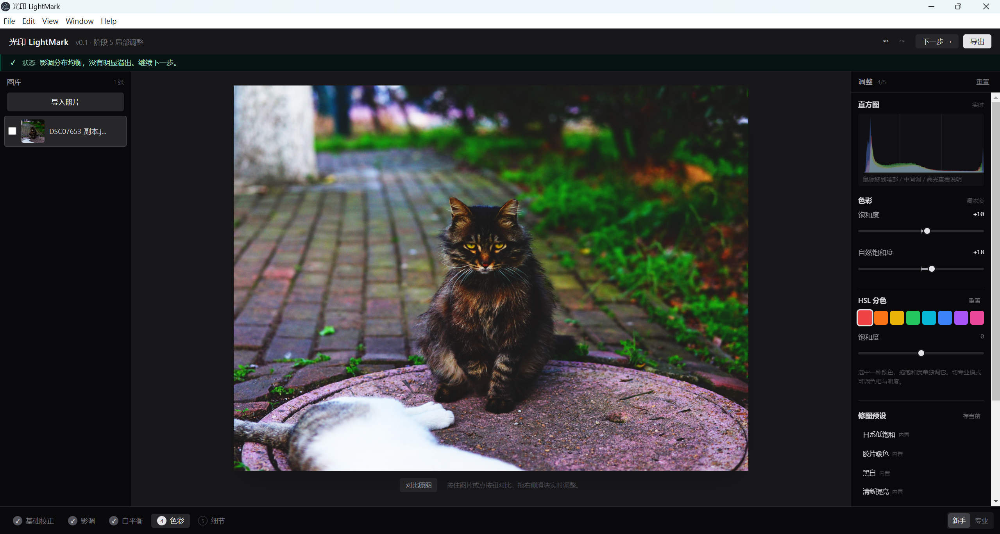

# 光印 LightMark

光印是面向摄影爱好者和非专业用户的非生成式修图 Agent 桌面 Demo。用户通过对话表达目标，Agent 可以基于当前照片调用传统参数工具，并把额外建议单独列出、等待用户确认。当前已接入通用 OpenAI Chat Completions 兼容多模态接口，含 Qwen、DeepSeek 预设和自定义 Base URL；真实服务商账户联调仍需在应用设置中完成。

## 项目截图



截图展示了图库、画布预览、直方图、色彩调整、HSL 分色、修图预设和流程状态。当前界面中的建议来自本地规则引擎，不代表已经接入视觉大模型。

## 当前功能

- Electron + React + TypeScript + Tailwind 桌面应用
- 图片导入与缩略图生成；每次导入的一组照片创建一个持久工作组
- 工作组级 Agent 对话：组内切换照片沿用同一段对话，切换工作组恢复各自历史；对话摘要与待确认建议随组保存
- 曝光、对比度、影调、白平衡、色彩、锐化和降噪
- 实时预览、直方图、前后对比和参数重置
- 新手模式与专业模式
- 规则建议：根据直方图和调整参数提示高光溢出、死黑、偏色等问题
- BYOM 多模态 Agent 侧栏：当前照片缩小预览、工作组内跨照片对话、自动摘要压缩、受限 EditPlan 与独立建议确认
- Qwen／DeepSeek／自定义 OpenAI 兼容模型设置，主进程请求、系统加密存储 API Key、首次传图授权
- 渐变、径向和笔刷局部调整
- Agent 自动天空局部修图：直接说“压暗天空”即可优先复用现有天空蒙版，缺失时由本机 Worker 生成临时选区；通过模型计划校验后才把天空蒙版与局部参数作为单条可撤销事务保存
- 手动天空候选入口仍保留供专业检查／修正：按 Alt 检查红色覆盖、笔刷修正、用户采纳后启用；本地分割本身不向 BYOM／中转站／云分割 API 上传照片
- HSL 八色分区调色
- 修图预设、历史记录、撤销/重做、裁剪和旋转
- 高质量单张导出、批量导出和导出预设
- 调整参数以 sidecar 文件持久化，原图不被修改

## 产品思路

LightMark 面向会拍照、但不熟悉专业修图软件的用户。用户可用自然语言表达目标；已接入的 Agent 通过可配置多模态接口理解当前照片，再将输出限制为白名单内的传统参数调整。用户明确要求的安全操作可校验后执行；Agent 主动发现的问题要说明现象和理由，作为独立建议等待用户确认。已做调整可预览、微调和撤销。后续可探索参考图风格匹配：把参考图的色调／色彩特征转成可编辑参数，而不是生成或替换图像内容。

## 需求与计划文档

- [Agent 修图需求文档](docs/03-agent修图需求文档.md)
- [竞品调研与 Agent 实施计划](docs/04-竞品调研与Agent实施计划.md)
- [新增需求评审清单](docs/05-新增需求评审清单.md)
- [批次筛选与图层专项调研](docs/06-批次筛选与图层专项调研.md)
- [详细方案计划表](docs/02-详细方案计划表.md)
- [本地自动天空候选蒙版 POC](docs/08-本地自动天空候选蒙版POC.md)
- [P1c 人物自动选区技术方案](docs/09-P1c人物自动选区技术方案.md)

## 项目架构

```text
Electron 主进程
  -> 文件选择、文件访问、导出与本地持久化；受控 BYOM 请求与密钥保护
React/TypeScript 渲染进程
  -> 工作台、持久工作组、调整面板、按组 Agent 对话与交互状态；本地分割 Worker 生成候选蒙版
Canvas 图像处理层
  -> 预览、参数应用、裁剪旋转和局部调整
Advisor 规则层
  -> 读取直方图与调整参数，生成可解释提示
sidecar 文件
  -> 保存调整参数，原图保持不变
```

## 典型工作流

1. 新建工作组并一次导入一组照片；再次打开该工作组会恢复组内照片与对话。
2. 按基础校正、影调、色彩和细节等阶段逐步调整。
3. 在工作组内切换照片时继续使用该组 Agent 对话；切换到其他工作组则进入该组独立对话。
4. 通过实时预览、直方图和前后对比观察变化；使用局部调整、HSL 或预设继续处理。
5. 保存非破坏性调整参数，或导出单张、当前工作组选中的照片。

## 项目验证

- 已通过前端构建检查和 Electron 启动检查。
- 已验证图片导入、预览、调整、历史记录、撤销/重做、裁剪旋转和导出流程。
- 已用实际照片完成调色工作台截图，截图展示图库、画布、直方图、HSL 和规则建议。
- Agent 模型前工具闭环已通过 27 项 EditPlan 安全测试；既有图像算法和历史测试 91 项通过；严格 TypeScript 检查与 Vite 生产构建通过。
- Provider 解析与安全测试已通过；当前环境未配置服务商 API Key，因此尚未执行真实 Qwen／DeepSeek 云端联调。
- 本地 SegFormer 语义分割模型已用合成图完成下载、加载与 `sky` 输出验证；Agent 自动天空路由、模型计划必须引用自动选区、原子事务撤销／恢复及查看范围入口已实现。真实照片（树叶／建筑边缘）、真实服务商模型计划和设备耗时仍待人工端到端验收。
- P1c 人物自动选区首轮公开样例本地 smoke test 已完成，但 DETR panoptic q8 与 SegFormer ADE20K q8 均未通过质量门槛；当前没有人物自动 Agent 路由，仍使用手动蒙版。结果与 overlay 见 [P1c 人物自动选区技术方案](docs/09-P1c人物自动选区技术方案.md)。
- 2026-10-20：浅色工作台、持久工作组、每组独立 Agent 对话、组内当前照片记忆和组间照片过滤已接入。严格 TypeScript 检查、隔离 Vite 构建及 `npm run test:agent` 全套 73 项回归通过。Electron 目视验收尚未通过：隔离窗口遇到 GPU／profile ACL／URL 加载错误；当前旧主进程的窗口在热更新后显示白屏，需在保存工作后重启 Electron，让新增 main/preload IPC 生效。
- 运行 Agent 安全测试：`npm run test:agent`。

## 运行环境

- Node.js
- npm
- Windows（当前主要目标平台）

安装依赖并启动开发环境：

```bash
npm install
npm run dev
```

构建前端资源：

```bash
npm run build
```

运行构建后的桌面应用：

```bash
npm start
```

## 项目状态

当前版本已完成基础修图、局部调整、HSL、预设、历史记录、几何调整和导出功能，并把 Agent 侧栏接入实际工作台。通用 OpenAI 兼容 BYOM 请求、Qwen／DeepSeek 视觉模型预设、图片上传授权、API Key 加密保存、EditPlan 安全校验和用户确认建议均已落地。用户可直接用自然语言请求天空修图：本地自动选区优先复用已有蒙版，缺失时生成内存临时蒙版；只有模型计划确实作用于该天空蒙版后才会保存，且与局部参数合并成一条可撤销事务。手动候选与修正入口仍保留。当前真实照片边缘质量、设备耗时及真实服务商端到端计划仍待验收；后续目标分割验证仍按“人物 → 宠物 → 背景”优先。API Key 不要发在聊天消息中。项目仍属于个人 Demo。

左侧工作组现表示一次持续修图工作：每次导入一组照片会创建新的工作组与独立对话，组内切换照片不会拆分会话；切换工作组会恢复该组对话。旧版图库照片会迁移到一个旧版工作组。当前工作组尚不包含完整的连拍筛选、批次配方或导出覆盖策略。

## 目录结构

```text
src/
├── main/       Electron 主进程与文件 IPC
├── renderer/   React 界面、状态和组件
├── image/      图像调整与几何处理
├── agent/      BYOM Provider、EditPlan 校验与安全执行协议
└── advisor/    修图建议规则引擎
docs/           产品设计和阶段计划
```

## 开发说明

项目主要采用 AI-native 方式开发：由项目负责人确定真实使用场景、产品目标、功能范围、交互要求、技术约束和验收标准，再使用 AI 编程工具完成实现协作、测试补充和问题排查。代码、文档和测试结果应以实际运行结果为准。

## 许可证

当前为个人 Demo。发布或商用前请分别确认依赖、模型和素材的许可证要求。
